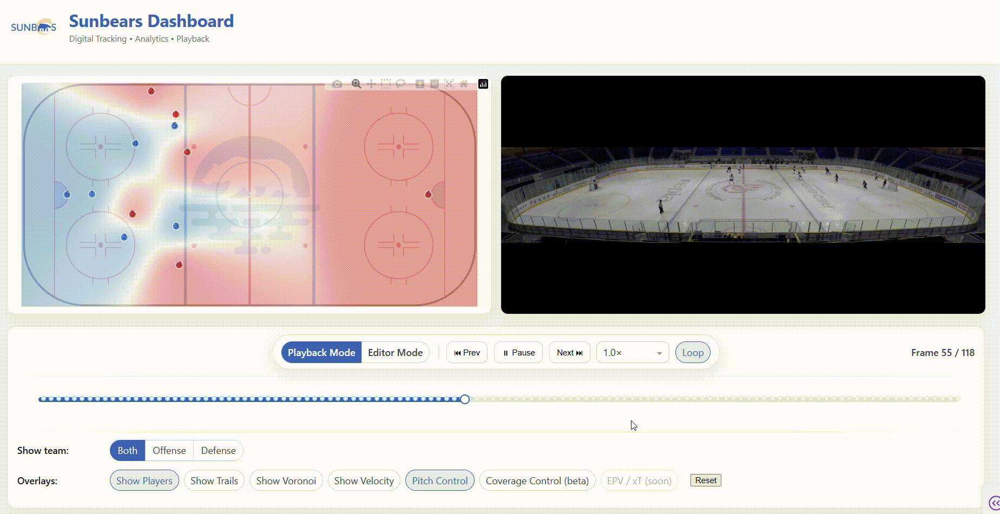

# Sunbears Sports Analytics Dashboard (Dash)



Interactive hockey tracking dashboard built with **Python + Dash**.

Displays player positions on a rink background, allows frame-by-frame playback, and supports overlays such as trails and Voronoi regions. Can also display a short synchronized video alongside the tracking plot.

## Features

- **Interactive Playback**
  - Single timeline slider for entire sequence
  - Centered playback controls: Prev / Play / Next / Speed / Loop
  - Frame indicator: `Frame i / N`  
    - Stops at last frame; Play restarts from beginning
- **Overlays**
  - Player markers
  - Fixed-length trails (default length from file)
  - Voronoi regions clipped to rink boundaries
  - Pitch control, scoring threat and a reference defense (see [Defensive analytics](#defensive-analytics))
- **Defensive analytics panel**
  - Scoring threat over the clip against the tracked defense and against the reference defense
  - Threat of the current frame, clip averages and the share of each attacker
  - Click the timeline to jump to that moment
- **Layout**
  - Left: Tracking visualization
  - Right: Video player (optional)
- **Header**
  - Sunbears icon and title
  - Subtitle for description
- **Responsive design** with custom CSS styling

## Defensive analytics

The `analytics/` package brings the models of the pitch-control coverage work
(`ice_hockey_simulator`, branch `experimental/pitch-control-coverage`) into the dashboard.
It needs only numpy and pandas.

| In the dashboard | What it is |
|---|---|
| **Pitch Control** overlay | Physics-based control model of Spearman: the probability that the attack gets to a puck sent to each location first. Red is the attack, blue the defense. |
| **Scoring Threat** overlay | Where the attack's chance of a goal comes from: scoring probability × chance that the puck goes there × attack control. Its sum over the ice is the off-puck scoring opportunity (OBSO), the chance that the next puck event ends in a goal. The colour scale is fixed, so frames and clips can be compared. |
| **Reference Defense** overlay | Green markers `2′, 3′, …`. In Playback Mode: a defending unit that starts where the tracked defenders start and then follows pitch-control coverage (each defender moves to the centroid of the threat it can contest) against the tracked attack, under skater speed and acceleration limits. In Editor Mode: the positions the same law suggests for the frame as drawn. |
| **Defensive analytics** panel | Threat over the clip against the tracked defense and against the reference defense, the threat of the current frame, clip averages and the threat carried by each attacker. In Editor Mode the numbers follow the players you drag. |

How to read it:

- A lower scoring threat means a better defense. The gap between the two lines is threat
  that was defendable by positioning alone.
- The tracked attack does not react to the reference defense, so the gap is not a
  prediction of what would have happened.
- **Puck carrier.** Tracking clips often have no puck. By default every result is the
  average over the attackers who may have it; choose a carrier in the panel if you know it
  (one carrier for the whole clip).
- The engine reads from the clip what it does not say: the frame rate and velocity units
  (velocities per second give the frame rate; velocities per frame or none fall back to
  10 fps, set `TRACKING_FPS` in `app.py` to override), which goal is defended, and the
  goalies (players who stay in front of a goal for the whole clip; they are left out because
  the scoring model already stands for the goalie). The panel prints what was inferred.
- Model constants (skating speed 8 m/s, reaction time 0.5 s, stick reach 1.5 m, pass speed
  20 m/s, the stylised scoring surface) are those of the paper and live in
  `analytics/pitch_control.py`, `analytics/threat.py` and `analytics/coverage.py`.
- The replay of the reference defense takes a few seconds per clip and carrier; it runs in
  the background and the panel fills in when it is ready.

Not in the dashboard: the barrier-function layer of the simulator (pass lanes, formations),
which needs a QP solver.

Tests: `pytest tests`

## Repository Structure

- `app.py` — Main Dash application (layout, callbacks, figure rendering)
- `utils.py` — Utility functions (Voronoi computation, polygon clipping)
- `analytics/` — Defensive analytics
  - `pitch_control.py` — Physics-based pitch control
  - `threat.py` — Scoring and transition models, off-puck scoring opportunity
  - `coverage.py` — Pitch-control coverage law (the reference defense)
  - `engine.py` — Per-clip engine: units, attack direction, goalies, puck carrier, replay
  - `rink.py` — Rink geometry and grids
- `tests/` — Tests of the analytics package
- `assets/`
  - `app.css` — Custom styling
  - `defensive_players_hockey.csv` — Example defense player tracking
  - `offensive_players_hockey.csv` — Example offense player tracking
  - `field_hockey.png` — Rink background
  - `sunbears_icon.webp` — Dashboard icon
  - `sample_video.mp4` — Example synchronized video (optional)

## Data Format

Two CSV files are expected:

- **Defensive players** — `assets/defensive_players_hockey.csv`
- **Offensive players** — `assets/offensive_players_hockey.csv`

**Required columns:**
- `timeframe` (or `timestamp`)
- `player_id`
- `x`
- `y`

The app will:
- Map `timeframe` → `timestamp` if necessary
- Coerce `timestamp` to `int`
- Coerce `player_id` to `str`
- Coerce `x` and `y` to `float`
- Assign team labels based on the file source (Defense/Offense)

## Running the App

1. Install dependencies:
   ```bash
   pip install dash plotly pandas shapely scipy
   ```
2. Place your CSV files and optional video in the assets/ folder.
3. Run:
   ```bash
   python app.py
   ```
4. Open the local server in your web browser

## Notes

- The Voronoi overlay uses `scipy.spatial.Voronoi` and `shapely` for clipping to rink boundaries.
- Styling is handled automatically by Dash loading `assets/app.css`.
- To change team colors, update the color map in `app.py` or CSS classes in `app.css`.

### Future Development

Pitch control, a scoring-threat measure and coverage control are now in the dashboard
(see [Defensive analytics](#defensive-analytics)). Next:

- **Puck tracking** — read the carrier per frame from the data instead of one choice per clip.
- **Fitted models** — scoring and transition models fitted to tracking and event data, and
  **xT / EPV** surfaces in place of the stylised scoring surface.
- **Formations and pass lanes** — the barrier-function layer of the simulator.
